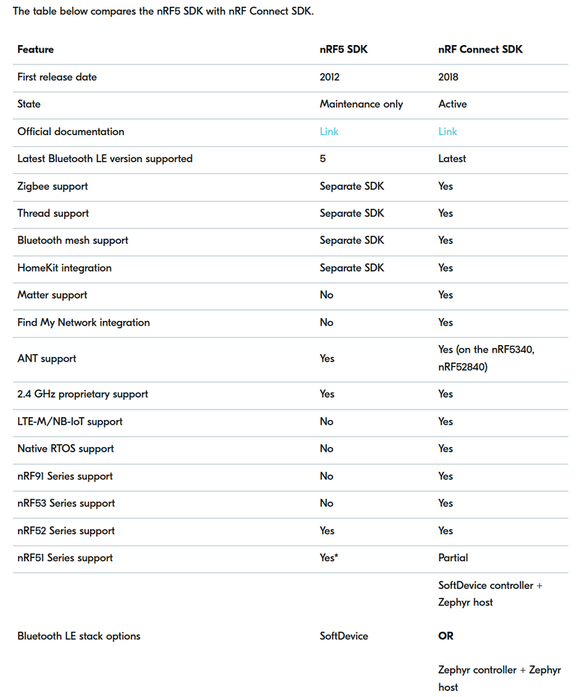
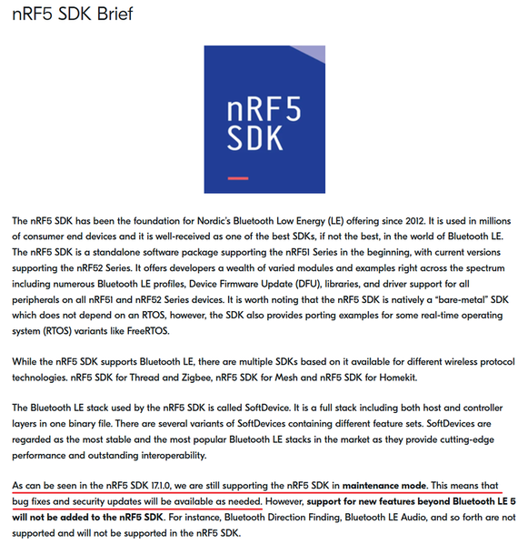
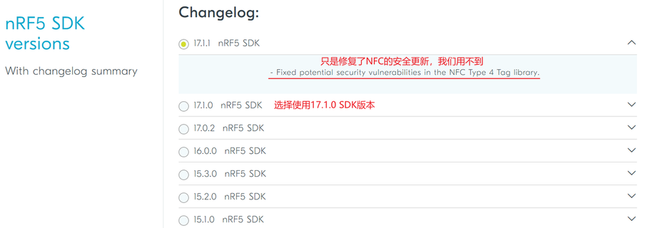
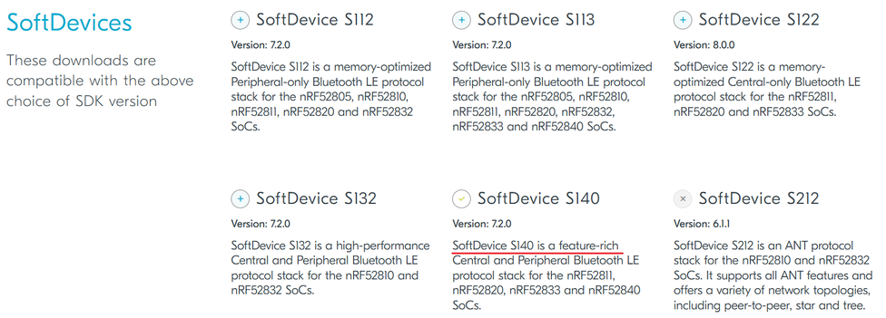
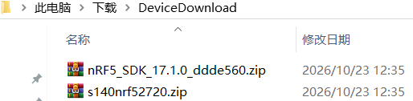
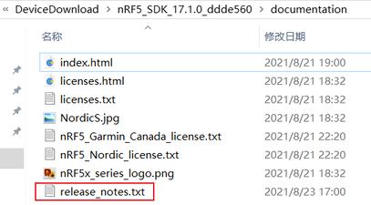
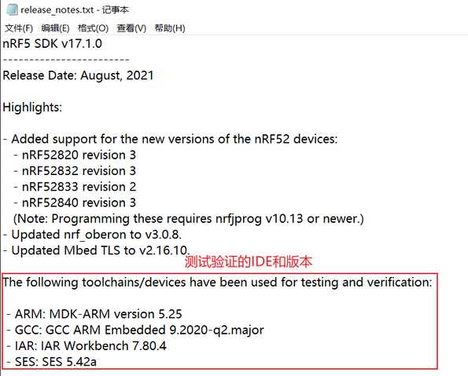
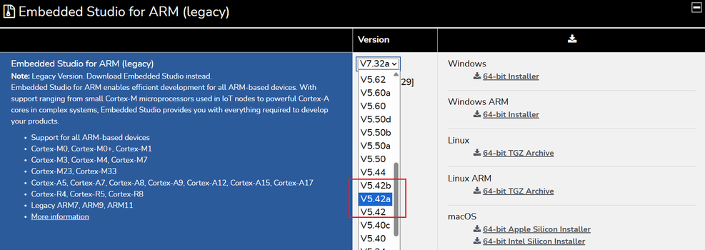
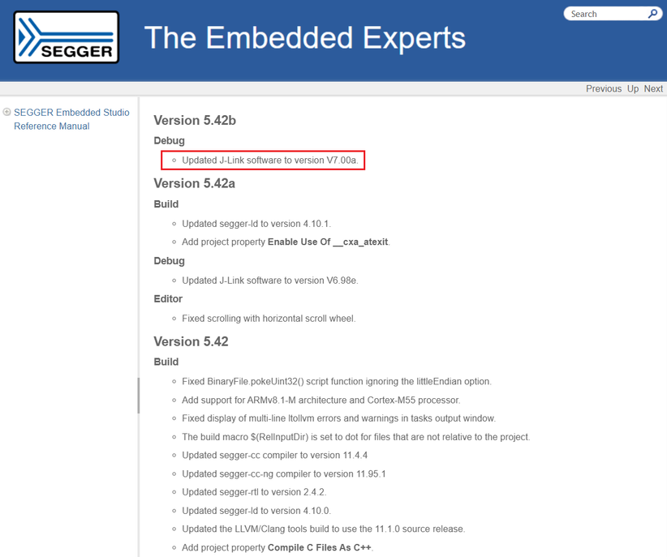
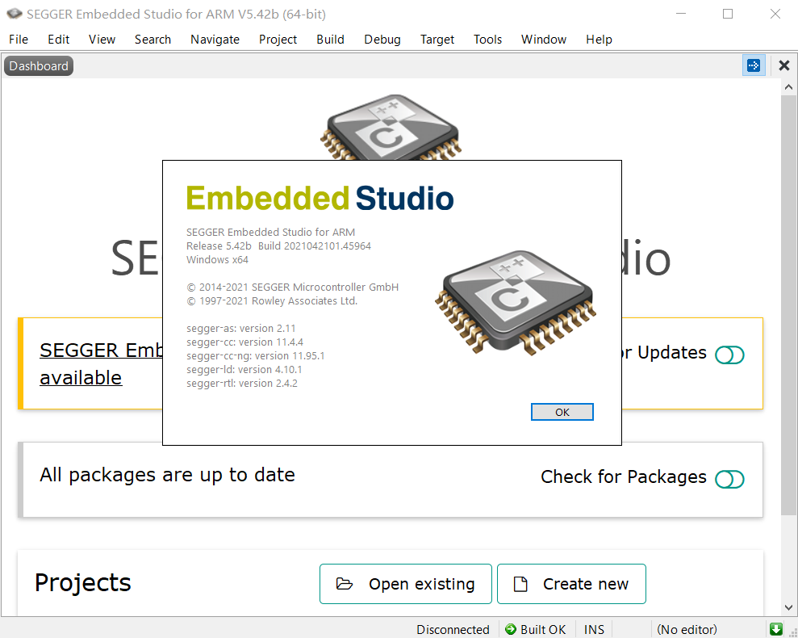

# 开发环境搭建

搭建开发环境，需要下载的资源：

+ nRF5 SDK: v17.1.0
+ SofDevice : S140
+ IDE : SEGGER Embedded Studio for ARM v5.42b

## [nRF52840芯片特性](https://www.nordicsemi.com/Products/nRF52840)

+ 64M CPU主频
+ 256KB RAM + 1MB Flash
+ ARM Cortex-M4，带FPU
+ 低功耗蓝牙、mesh组网
+ 128位 AES CCM
+ USB 2.0

## nRF开发SDK

Nordic官方提供了2套SDK：nRF Connect SDK(新)、nRF5 SDK(在线)。[两个SDK的官方维护状态：](https://devzone.nordicsemi.com/nordic/nordic-blog/b/blog/posts/nrf-connect-sdk-and-nrf5-sdk-statement)

### [nRF Connect SDK典型特性](https://www.nordicsemi.com/Products/Development-software/nRF-Connect-SDK)

+ 基于Zephyr RTOS
+ 目标芯片：全系列
+ 当前状态：积极开发 + 官方主推
+ 抽象层次：偏应用层开发

### [nRF5 SDK典型特性](https://www.nordicsemi.com/Products/Development-software/nRF5-SDK/)

+ 基于裸机或FreeRTOS
+ 目标芯片：nRF51、nRF52系列
+ 当前状态：维护模式。仍在修复问题和安全更新，但不新增功能
+ 抽象层次：偏底层，有更多硬件相关细节

我们学习nRF52840，选择nRF5 SDK。原因是nRF5 SDK有丰富的例程代码，有详细的底层技术细节，能学到更多的基础知识。

## [nRF5 SDK选择+下载](https://www.nordicsemi.com/Products/Development-software/nRF5-SDK/)

在这一部分，我们需要下载nRF5 SDK和SoftDevice协议栈。

### nRF5 SDK v17.1.0

前面nRF5 SDK Brief图片中提到了v17.1.0版本，而最新的v17.1.1只是增加了NFC安全更新，我们用不到。所以，选择nRF5 SDK v17.1.0版本。

### SoftDevice s140

SoftDevice s140是资源最丰富、综合性能最好、最稳定的协议栈版本。

nRF5 SDK + s140下载内容：

## nRF5开发IDE

nRF5 SDK支持多款开发IDE。前面下载了nRF5 SDK 17.1.0，SDK里面release_notes.txt介绍了当前SDK测试验证的SDK，已经对应版本。

release_notes.txt文件路径：

nRF5 SDK 11.7.0支持的IDE及版本：

+ Keil MDK : 5.25
+ IAR : 7.80.4
+ SEGGER Embedded Studio For ARM(推荐) : 5.42a
+ GCC

Nordic官方推荐使用SES来进行开发，看下如何下载。

### [SEGGER Embedded Studio下载](https://www.segger.com/downloads/embedded-studio/)

我们可以选择下载5.42a，也可以下载5.42b，这俩都可以。5.42b只是更新了J-Link驱动，根据社区描述，5.42b是能够长期使用的稳定版本。

arm_segger_studio_release_notes路径：`SEGGER Embedded Studio/html/arm_segger_studio_release_notes.htm`

### SEGGER Embedded Studio for ARM 5.42b安装完成

