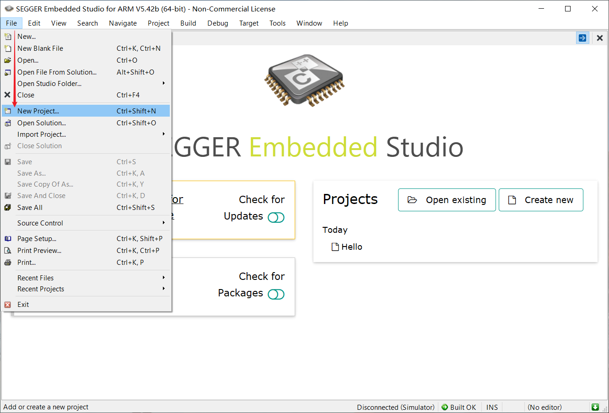
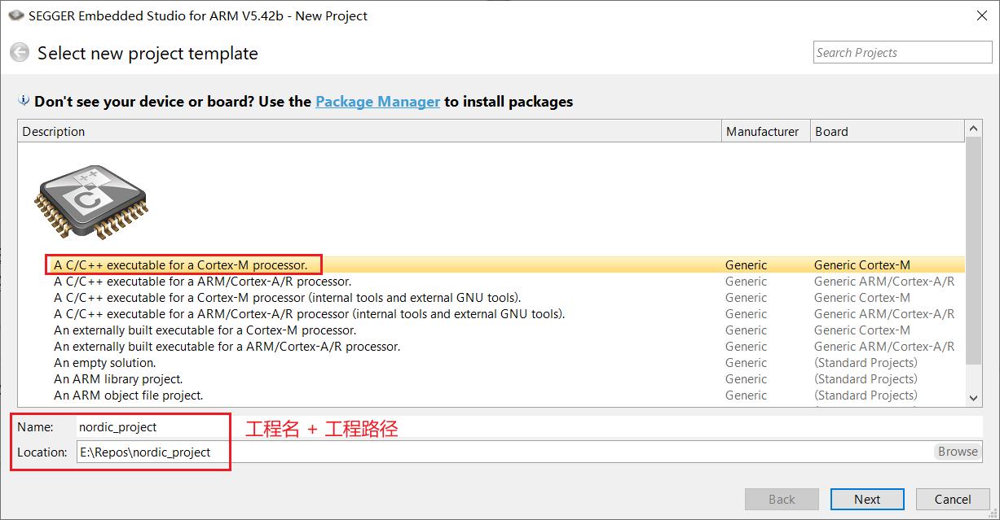
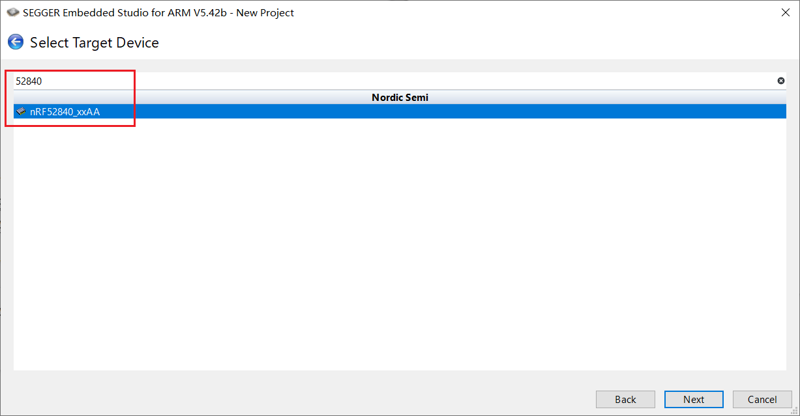
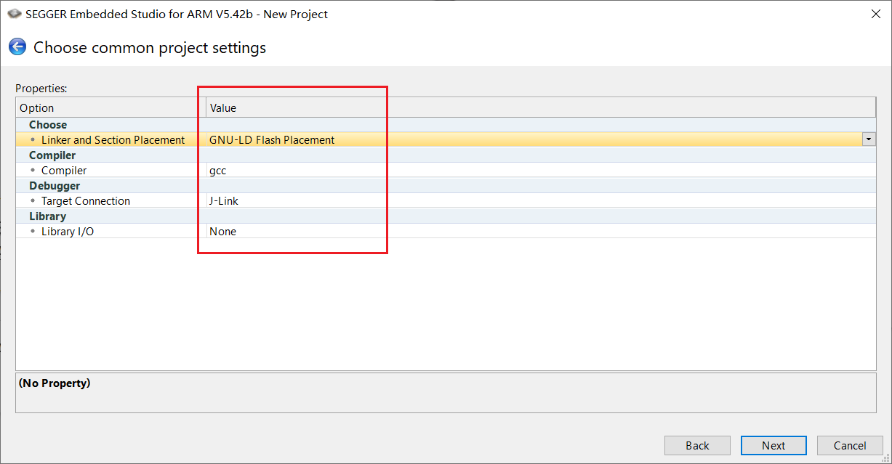
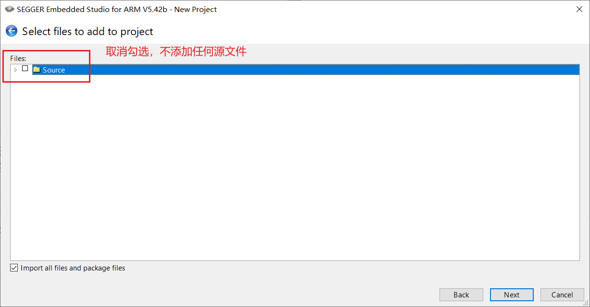
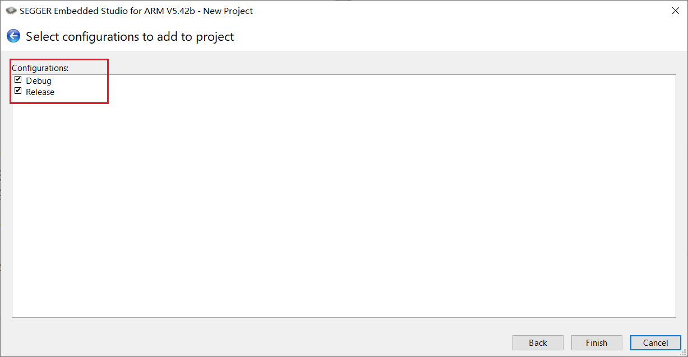

# SEGGER Embedded Studio新建工程

本节使用SES新建Nordic 52840工程。目标如下：

+ 使用gcc编译
+ 使用gnu ld作为链接脚本
+ 使用ses IDE来管理文件

## 1. 新建工程

### 1.1 File -> New Project

### 1.2 选择`project template`，设置工程名 + 工程路径

### 1.3 选择`target device`

### 1.4 设置编译器、连接器和调试器

### 1.5 默认不添加源文件

### 1.6 默认`Debug`和`Release`两个配置

工程创建成功！

## 配置工程

