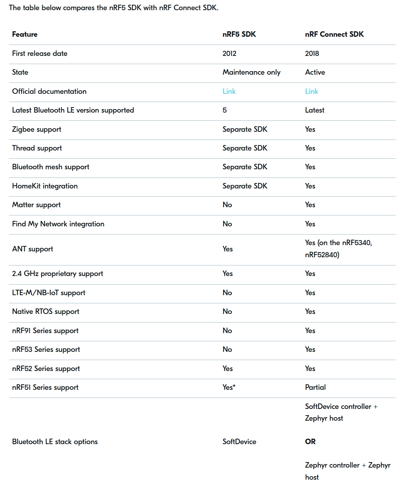

# 开发环境搭建

## [nRF52840芯片特性](https://www.nordicsemi.com/Products/nRF52840)

+ 64M CPU主频
+ 256KB RAM + 1MB Flash
+ ARM Cortex-M4，带FPU
+ 低功耗蓝牙、mesh组网
+ 128位 AES CCM
+ USB 2.0

## nRF开发SDK

Nordic官方提供了2套SDK：nRF Connect SDK(新)、nRF5 SDK(在线)。[两个SDK的官方维护状态：](https://devzone.nordicsemi.com/nordic/nordic-blog/b/blog/posts/nrf-connect-sdk-and-nrf5-sdk-statement)

### [nRF Connect SDK典型特性](https://www.nordicsemi.com/Products/Development-software/nRF-Connect-SDK)

+ 基于Zephyr RTOS
+ 目标芯片：全系列
+ 当前状态：积极开发 + 官方主推
+ 抽象层次：偏应用层开发

### [nRF5 SDK典型特性](https://www.nordicsemi.com/Products/Development-software/nRF5-SDK/)

+ 基于裸机或FreeRTOS
+ 目标芯片：nRF51、nRF52系列
+ 当前状态：维护模式。仍在修复问题和安全更新，但不新增功能
+ 抽象层次：偏底层，有更多硬件相关细节

我们学习nRF52840，选择nRF5 SDK

